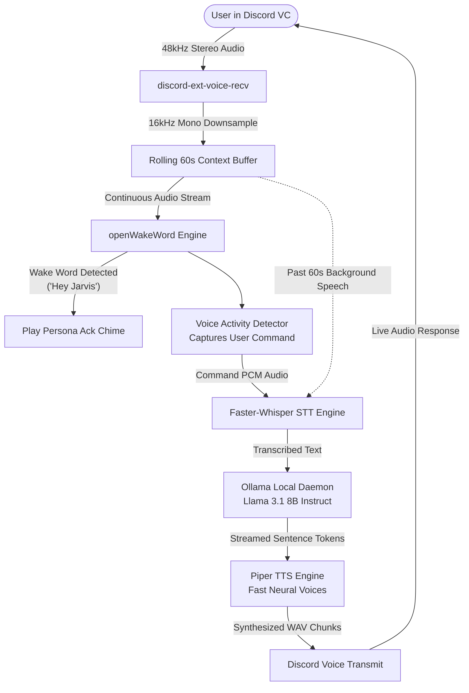

# 🎙️ Yeo Discord Voice Bot - All-in-One Google Colab Runner Guide

[](https://colab.research.google.com/github/Oreozisbored/yeofiles/blob/main/colab/yeo_all_in_one_colab.ipynb)

This guide explains how to run the **Yeo Discord Voice Assistant Bot** alongside a local **Meta Llama 3.1 8B Instruct** Large Language Model in a single, self-contained **Google Colab notebook** using Colab's free GPU tier.

---

## 📑 Table of Contents
1. [Overview & Architecture](#-overview--architecture)
2. [Prerequisites & Discord Setup](#-prerequisites--discord-setup)
3. [Step-by-Step Running Guide](#-step-by-step-running-guide)
4. [In-Discord Usage & Commands](#-in-discord-usage--commands)
5. [Configuration & Environment Variables](#-configuration--environment-variables)
6. [Advanced Features](#-advanced-features)
7. [Troubleshooting & FAQs](#-troubleshooting--faqs)

---

## 🧠 Overview & Architecture

Normally, running an AI voice assistant bot in Discord requires three things:
1. A Discord bot process connected to voice channels.
2. An STT (Speech-to-Text) and TTS (Text-to-Speech) pipeline.
3. A powerful GPU server or paid API running an LLM.

The **All-in-One Colab Runner** (`colab/yeo_all_in_one_colab.ipynb`) bundles everything into one notebook running inside Google Colab's free **T4 GPU** environment:



### ⚡ Key Highlights:
- **Zero Local Hardware Requirement:** Runs entirely in Google Colab (no gaming PC or local GPU required).
- **Free Meta Llama 3.1 8B:** Powered by Ollama on Colab's GPU; no OpenAI or Anthropic API bills.
- **Ultra Low Latency:** Piper neural TTS synthesizes responses sentence-by-sentence as soon as words are generated.
- **Context-Aware:** Keeps a circular rolling buffer of the past 60 seconds of voice chat, allowing the bot to understand queries like *"What was John just talking about?"*.
- **Soundboard & Persona Support:** Dynamic personality switching (`/mode`) with custom audio acknowledgement chimes.

---

## 🛠️ Prerequisites & Discord Setup

Before running the Colab notebook, prepare your Discord bot credentials:

### 1. Create a Discord Bot Application
1. Go to the [Discord Developer Portal](https://discord.com/developers/applications).
2. Click **New Application** and give it a name (e.g., `Yeo Bot`).
3. Navigate to the **Bot** tab on the left sidebar.
4. Click **Reset Token** and copy your **Discord Bot Token**. Keep this token safe and private!

### 2. Enable Privileged Gateway Intents
In the **Bot** tab, scroll down to **Privileged Gateway Intents** and enable:
- ✅ **Message Content Intent** (Required for commands and chat listening)
- ✅ **Server Members Intent** (Recommended for user identification)

### 3. Invite the Bot to Your Discord Server
1. Go to the **OAuth2** -> **URL Generator** tab.
2. Select scopes:
   - `bot`
   - `applications.commands`
3. Under **Bot Permissions**, check:
   - **Send Messages**
   - **Embed Links**
   - **Attach Files**
   - **Read Message History**
   - **Connect** (Voice)
   - **Speak** (Voice)
   - **Use Voice Activity**
4. Copy the generated URL at the bottom, paste it into your browser, and add the bot to your server.

### 4. Obtain Your Discord User ID (Bot Owner ID)
1. In Discord, go to **User Settings** -> **Advanced** -> toggle **Developer Mode** on.
2. Right-click your own avatar/profile in any channel or member list and select **Copy User ID**.

---

## 🚀 Step-by-Step Running Guide

### Step 1: Open the Notebook in Google Colab
Click the badge below to open the notebook directly in Colab:

[](https://colab.research.google.com/github/Oreozisbored/yeofiles/blob/main/colab/yeo_all_in_one_colab.ipynb)

### Step 2: Select T4 GPU Runtime
1. In Google Colab's top menu bar, click **Runtime** -> **Change runtime type**.
2. Under **Hardware accelerator**, select **T4 GPU**.
3. Click **Save**.

### Step 3: Configure & Run Cell 1 (Environment Setup)
1. Fill in the form fields:
   - `DISCORD_TOKEN`: Paste your bot token from the Discord Developer Portal.
   - `BOT_OWNER_ID`: Paste your Discord User ID (gives you bot admin permissions).
   - `BOT_NAME`: Name the bot (default: `Yeo`).
   - `WAKE_WORD`: Select your preferred wake word:
     - `wakewords/Hey_yee_o.onnx` (Default: Custom-trained **Hey Yeo** model)
     - `wakewords/Hey_verity.onnx` (Custom-trained **Hey Verity** model)
     - `hey_jarvis`, `alexa`, `weather`, `timer` (Standard built-in models)
2. Click the **Run** button (or press `Shift + Enter`) on **Cell 1**.
3. **What Cell 1 does:**
   - Installs system multimedia packages (`ffmpeg`, `libopus0`, `libopus-dev`).
   - Installs the `ollama` daemon binary.
   - Clones the official bot repository and pulls the latest updates.
   - Safely syncs wake words and soundboard chimes from the public `yeofiles` CDN.
   - Installs compatible Python libraries (`numpy<2`, `discord-ext-voice-recv`, `openwakeword`, `piper-tts`, `faster-whisper`).
   - Pre-caches the default Piper voice model (`en_US-lessac-medium`) and openWakeWord models so bot startup is immediate.
   - Writes the `.env` configuration file inside the repository directory.

### Step 4: Run Cell 2 (Launch Ollama & Start Bot)
1. Click **Run** on **Cell 2**.
2. **What Cell 2 does:**
   - Verifies NVIDIA GPU detection via `nvidia-smi`.
   - Starts the background `ollama serve` process on `localhost:11434` and monitors readiness.
   - Downloads the **Meta Llama 3.1 8B Instruct** model (~4.7 GB) with live progress.
   - Boots the Discord bot client via `python3 code.py`.
3. In the cell output, you will see:
   ```text
   [INFO] YeoBot: === ONLINE as Yeo#1234 (aka Yeo) ===
   [INFO] YeoBot: ✅ Slash Commands Synced!
   ```
4. Keep the Google Colab browser tab open while you use the bot.

---

## 🎮 In-Discord Usage & Commands

Once the bot logs in, join any voice channel in your Discord server:

### Voice Interaction
1. Type `/join` in any text channel. The bot will join your voice channel.
2. Say the wake word:
   > *"Hey Yeo, what's the distance between the Earth and the Moon?"*
   *(or "Hey Verity..." / "Hey Jarvis...")*
3. The bot will play a quick persona chime (acknowledgement) and immediately answer your query via neural text-to-speech.
4. You can continue speaking to the bot naturally.

### Slash Commands Reference

| Slash Command | Parameters | Description |
|---|---|---|
| `/join` | *none* | Joins the user's current voice channel and starts listening for the wake word. |
| `/leave` | *none* | Stops listening and disconnects from the voice channel. |
| `/mode` | `persona` | Switch personality: `default`, `rude`, `uwu`, `pirate`, `gangster`, `shakespeare`, `nerd`. |
| `/modes` | *none* | View all built-in and user-created custom personalities. |
| `/add_mode` | `name`, `system_prompt` | Create and save a new custom persona on the fly. |
| `/del_mode` | `name` | Delete a previously saved custom persona. |
| `/voice` | `voice_name` | Change the Piper TTS voice model or list all available models. |
| `/tts_speed` | `speed` | Adjust speech velocity (`0.8x`, `1.0x`, `1.2x`, `1.5x`). |
| `/volume` | `percent` | Adjust bot playback volume (10% - 200%). |
| `/soundboard` | `sound` | Play sound effect: `airhorn`, `quack`, `drumroll`, `tada`, `wake_chime`. |
| `/say` | `text` | Forces the bot to synthesize and speak a custom phrase in VC. |
| `/wake_threshold` | `threshold` (0.1 - 1.0) | Tune wake word detection sensitivity (default: `0.5`). |
| `/pause_listening` | *none* | Temporarily pauses audio processing and wake word detection. |
| `/resume_listening`| *none* | Resumes continuous listening. |
| `/wipe` | *none* | Clears conversation memory for the server. |
| `/forget_last` | *none* | Removes only the most recent interaction from memory. |
| `/roast` | `user` | Generates a persona-themed funny roast of the tagged user. |
| `/compliment` | `user` | Generates a kind persona-themed compliment for the tagged user. |
| `/joke`, `/trivia`, `/poem` | *optional* | Generates entertaining content and speaks it if in VC. |
| `/calc` | `expression` | Evaluates arithmetic safely (`sqrt`, `log`, powers, etc.). |
| `/help` | *none* | Displays the interactive help guide and command list. |

---

## ⚙️ Configuration & Environment Variables

When Cell 1 executes, it writes a `.env` file that configures all bot modules:

| Variable | Default in Colab | Description |
|---|---|---|
| `DISCORD_TOKEN` | *(User Input)* | Bot authentication token from Discord Developer Portal. |
| `BOT_OWNER_ID` | *(User Input)* | Discord user ID permitted to execute admin commands. |
| `BOT_NAME` | `Yeo` | Display name used by the bot and AI system prompts. |
| `LLM_PROVIDER` | `openai` | API format for inference (`openai` standard compatible with Ollama `/v1`). |
| `LLM_API_BASE` | `http://localhost:11434/v1` | URL for the local Ollama daemon. |
| `LLM_MODEL` | `llama3.1:8b-instruct` | Ollama model identifier to query. |
| `WAKE_WORD` | `hey_jarvis` | openWakeWord model: `hey_jarvis`, `alexa`, `weather`, or `.onnx` path. |
| `WAKE_WORD_THRESHOLD` | `0.5` | Sensitivity threshold (lower = more sensitive, higher = fewer false triggers). |
| `PAST_CONTEXT_SECONDS` | `60` | Number of seconds of background voice audio retained in rolling buffer. |
| `SILENCE_TIMEOUT_SECONDS`| `2.0` | Seconds of silence after speaking before the bot finalizes your voice command. |
| `MAX_COMMAND_SECONDS` | `15.0` | Maximum recording length for a single voice utterance. |
| `DEFAULT_PIPER_VOICE` | `en_US-lessac-medium` | Default Piper ONNX voice model. |
| `DEFAULT_TTS_SPEED` | `1.0` | Normal speech pace multiplier. |
| `STT_MODEL_SIZE` | `base.en` | Faster-Whisper model size (`tiny.en`, `base.en`, `small.en`). |
| `STT_DEVICE` | `cpu` | Execution device for Faster-Whisper (`cpu` or `cuda`). |
| `STT_COMPUTE_TYPE` | `int8` | Precision quantization for Whisper inference (`int8` or `float16`). |

---

## 🌟 Advanced Features

### 1. Rolling 60-Second Audio Context
The bot maintains an uncompressed circular audio buffer in memory. When you speak the wake word, the bot transcribes both:
1. What you just asked.
2. What everyone in the channel said in the preceding 60 seconds.

This gives the model immediate awareness of the live conversation without needing to transcribe every word around the clock.

### 2. Sentence-by-Sentence Streaming TTS
Instead of waiting for the LLM to generate an entire paragraph before starting TTS, the bot streams tokens and synthesizes audio as soon as each sentence boundary (`.`, `!`, `?`, `\n`) is reached. The first sentence begins playing in Discord while the LLM is still drafting the second sentence!

### 3. Dynamic Custom Personas
You can switch the bot's behavior in real time:
- `/mode rude` - Sarcastic, funny roast mode.
- `/mode uwu` - Cute, bubbly kaomoji-speaking mode.
- `/mode pirate` - High seas buccaneer.
- `/mode gangster` - Street-smart vernacular.
- `/mode shakespeare` - Elizabethan dramatic bard.
- `/mode nerd` - Over-intellectual technical pedant.
- `/add_mode [name] [prompt]` - Add your own!

Each persona includes a distinct audio acknowledgement chime triggered immediately when the wake word is detected.

---

## ❓ Troubleshooting & FAQs

### Q1: Google Colab disconnected or stopped after a while
- **Cause:** Google Colab free tier sessions have an idle timeout (typically after 30-90 minutes of inactive browser focus) and a maximum 12-hour session duration.
- **Fix:** Keep the Colab browser tab open. If disconnected, simply re-run Cell 1 and Cell 2 to bring the bot back online.

### Q2: The bot joins the channel but doesn't react to the wake word
- **Fix 1:** Verify your microphone is active and not muted in Discord.
- **Fix 2:** Check your wake word threshold with `/wake_threshold 0.4` to make the detector more sensitive.
- **Fix 3:** Speak clearly with a short pause after the wake phrase (e.g., *"Hey Jarvis... what is the capital of France?"*).

### Q3: Slash commands do not show up when typing `/`
- **Cause:** Discord can take up to a few minutes to register global slash commands for newly created bots.
- **Fix:** In your server, type `!sync` to force an immediate guild-level command sync.

### Q4: Is my Discord Bot Token safe in Google Colab?
- **Yes**, as long as you do not share your private Colab session link with others or publish a notebook containing your saved token. The form field stores the token in memory only for the duration of that private runtime instance.
- **Best Practice:** Never commit `.env` files or notebooks with hardcoded tokens to public GitHub repositories.
